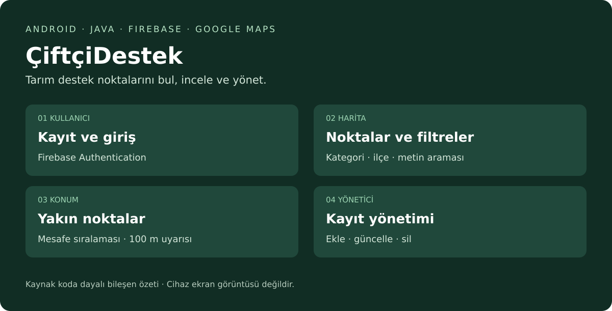
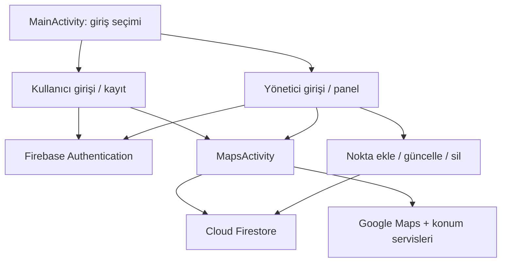

# ÇiftçiDestek — Tarım Destek Noktaları Mobil Uygulaması

**Tarımsal destek noktalarını haritada bulmayı, bilgilerine ulaşmayı ve yönetici hesabıyla kayıtları yönetmeyi sağlayan Android uygulaması.**

ÇiftçiDestek, kullanıcıların kategori, ilçe ve metin aramasıyla tarımsal destek noktalarına ulaşmasını amaçlar. Nokta bilgileri Firebase Firestore'da tutulur; harita ve konum işlevleri Google Maps ve Google Play Services üzerinden sağlanır. Bu depo mevcut mobil proje kaynaklarının düzenlenmiş sunumudur.


*Kaynak koddaki bileşenlerin açıklayıcı şemasıdır; cihazdan alınmış ekran görüntüsü değildir.*

## Özet

| Başlık | Açıklama |
|---|---|
| Problem | Tarımsal destek noktalarının konum ve iletişim bilgilerine tek uygulamadan erişim |
| Yöntem | Java ile Android arayüzü; Firebase Authentication, Cloud Firestore, Google Maps ve konum servisleri |
| Kullanıcı | Hesap oluşturma, giriş, haritada inceleme, arama/filtreleme, yakın noktalar ve dış uygulamalara yönlendirme |
| Yönetici | Rol kontrolünden sonra nokta ekleme, listeleme, güncelleme ve silme |
| Donanım | Android 7.0 / API 24 veya üzeri cihaz; harita/konum için Google Play Services, internet ve konum izni |
| Paket kimliği | `com.example.tarimmobilprojesi` |
| Makale/rapor | Kaynak ZIP'te makale veya proje raporu bulunmuyor; [teknik açıklama](docs/TEKNIK_ACIKLAMA.md) kaynak koddan hazırlanmıştır |
| Doğrulama | Kaynak, XML ve paket tutarlılığı kontrol edildi; bu hazırlık sırasında APK derlenmedi veya cihaz testi yapılmadı |

## Sistem mimarisi



Authentication hesap oturumunu yönetir. `users/{uid}` belgesindeki `role` alanı uygulamanın yönetici girişinde kontrol edilir. Noktalar `tarim_noktalari` koleksiyonundan okunur. Sunucu tarafındaki izinler `firestore.rules` dosyasına bağlıdır; mevcut kuralın rol alanını kullanıcı tarafından değiştirilebilir bırakması [bilinen sınırlar](docs/TEKNIK_ACIKLAMA.md#bilinen-sinirlar) bölümünde açıklanmıştır.

## Seçilmiş işlevler ve beklenen çıktılar

Kaynakta ekran görüntüsü, performans ölçümü veya deney sonuç tablosu bulunmadığından aşağıdaki liste kodda bulunan işlevleri ve kurulumdan sonra gözlenmesi beklenen davranışları gösterir.

| İşlev | Beklenen çıktı | Kaynak |
|---|---|---|
| Kullanıcı kaydı ve giriş | E-posta/şifreyle hesap; kullanıcı bilgileri ve `role=user` kaydı | `RegisterActivity`, `UserLoginActivity` |
| Harita, kategori/ilçe filtresi ve metin araması | Seçime uyan tarım noktalarının haritada gösterilmesi | `MapsActivity` |
| Yakındaki noktalar | Konuma göre mesafe sıralaması ve kilometre cinsinden mesafe | `MapsActivity` |
| Yakınlık uyarısı | Nokta merkezine mesafe ≤100 m olduğunda uygulama içinde uyarı | `MapsActivity.alanKontrolEt` |
| İletişim ve yol tarifi | Telefon çevirici, web sitesi ve harici harita uygulaması açılması | `MapsActivity` |
| Yönetici işlemleri | Nokta ekleme, arama, düzenleme ve silme | `AdminPanelActivity`, `AddPlaceActivity`, `UpdatePlaceActivity` |

Yakınlık uyarısı konum güncellemeleri sırasında gösterilen bir uygulama içi diyalogdur. Arka planda çalışan işletim sistemi geofence servisi olarak sunulmaz. Konum doğruluğu nedeniyle eşik çevresinde cihaz davranışı değişebilir.

## Kurulum

### Gereksinimler

- Projedeki Android Gradle Plugin 9.2.1 ve Gradle 9.4.1 sürümlerini destekleyen Android Studio.
- Gradle daemon için JDK 21: `gradle/gradle-daemon-jvm.properties` içinde tanımlıdır. Java kaynak uyumluluğu 11'dir.
- Android SDK: kaynak `app/build.gradle` içinde `release(36)` ve `minorApiLevel=1`, targetSdk 36, minSdk 24 tanımlanmıştır. IDE'nin bu tanıma karşılık gelen SDK/Build Tools bileşenlerini kurmasına izin verin.
- Google Play Services içeren Android cihaz veya uygun emülatör.
- Kendi Firebase projeniz ve Maps SDK for Android erişimi. Paket özgün hesaba ait bağlantı dosyasını ve Maps anahtarını içermez.

### Adımlar

1. ZIP'i açın. Android Studio → **Open** ile `settings.gradle` ve `README.md` bulunan proje kökünü seçin.
2. IDE'nin SDK yolunu `local.properties` içine oluşturmasını sağlayın. Mevcut `sdk.dir` satırını koruyun.
3. [Firebase ve harita kurulumunu](docs/KURULUM.md) tamamlayın: `app/google-services.json` dosyasını ekleyin ve `local.properties` içine `MAPS_API_KEY=...` yazın.
4. Gradle Sync çalıştırın. Gerekirse Gradle JDK ayarını JDK 21 yapın; ilk eşitleme internet erişimi gerektirir.
5. Cihazı/emülatörü seçip **Run 'app'** düğmesine basın.

Beklenen açılış: **ÇiftçiDestek**, **Kullanıcı Girişi** ve **Admin Girişi** seçenekleri. Uygulama Firebase ayarları olmadan derlenmeyebilir; geçerli Maps anahtarı olmadan harita döşemeleri yüklenmez.

### Terminal komutları

Windows PowerShell:

```powershell
.\gradlew.bat --version
.\gradlew.bat :app:assembleDebug
```

macOS/Linux:

```bash
chmod +x gradlew
./gradlew --version
./gradlew :app:assembleDebug
```

Başarılı derlemede beklenen son durum `BUILD SUCCESSFUL`, APK yolu `app/build/outputs/apk/debug/app-debug.apk` olur. Bu paketin hazırlanması sırasında bu derleme çalıştırılmadı; Android SDK/emülatör ortamı hazır değildi ve yerel Java sürümü 17 idi.

## Kullanım

1. **Kullanıcı Girişi → Kayıt Ol** üzerinden hesap oluşturun.
2. Giriş yapın; harita açılınca konum iznini verin.
3. Kategori/ilçe ve arama alanını kullanarak noktaları inceleyin. Kayıt yoksa önce yöneticiyle nokta eklenmelidir.
4. Noktaya dokunarak detayları görün; telefon, web veya yol tarifi işlemini seçin.
5. Yönetici kullanımında kendi test hesabınızın `users/{uid}` belgesini yetkili Firebase Console erişimiyle `role=admin` olarak ayarlayın; **Admin Girişi** ile giriş yapın.

Yeni yönetici hesabı uygulamanın kayıt ekranından otomatik oluşturulmaz. Veri şeması ve örnek alan değerleri [kurulum rehberinde](docs/KURULUM.md#veri-semasi) açıklanmıştır. Gerçek bir veri tabanı dökümü ZIP'te bulunmuyor.

## İşlevleri yeniden gösterme / kontrol etme

| Çıktı | Yeniden gösterme adımı |
|---|---|
| Açılış ve giriş ekranları | `:app:assembleDebug` ardından Run 'app' → giriş türünü seç |
| Harita, filtre ve arama | Test hesabıyla giriş → kayıt eklenmiş Firestore → harita filtresi/arama |
| Yakınlık uyarısı | Emülatörde bir test noktasının koordinatına konum ver → ≤100 m mesafede uygulama içi uyarıyı kontrol et |
| Yönetici CRUD | Test yöneticisiyle giriş → Yeni Nokta Ekle → Güncelle → Sil |
| Gerçek ekran görüntüleri | Cihaz/emülatör ekran yakalama işlevi; yönerge: [gösterim kontrolü](docs/GOSTERIM_KONTROLU.md) |

Bu tablo uygulanacak kontrol adımlarıdır; tamamlanmış cihaz testi raporu değildir. Kaynaktaki `ExampleUnitTest` ve `ExampleInstrumentedTest` varsayılan şablon testleridir; uygulama işlevlerini doğrulamaz. Uygun SDK ortamında `:app:testDebugUnitTest` ve `:app:connectedDebugAndroidTest` görevleri çalıştırılabilir.

## Proje yapısı

| Yol | Açıklama |
|---|---|
| `app/src/main/java/` | Uygulamanın özgün Java kaynakları |
| `app/src/main/res/` | XML arayüzler, temalar, renkler ve simgeler |
| `app/src/main/AndroidManifest.xml` | Ekranlar, izinler ve yerel Maps anahtarı bağlantısı |
| `app/src/test/`, `app/src/androidTest/` | Kaynaktaki varsayılan test dosyaları |
| `app/build.gradle`, `build.gradle`, `settings.gradle` | Android proje/derleme tanımları |
| `gradle/`, `gradlew`, `gradlew.bat` | Kaynaktaki Gradle Wrapper ve sürüm kataloğu |
| `firestore.rules` | Özgün Firestore kuralları |
| `local.properties.example` | Yerel Maps ayarı örneği |
| `docs/` | Kurulum, teknik açıklama, gösterim ve yükleme rehberleri |
| `assets/` | Kaynak işlevlere dayanan açıklayıcı şema |

## Atıf, lisans ve iletişim

Proje adı arayüzde **ÇiftçiDestek**, Android proje adı **Tarim Mobil Projesi** olarak geçer. Kaynak ZIP'te doğrulanabilir yazar listesi, makale künyesi veya lisans bulunmadığından eklenmedi. Yazar ve ders bilgileri depo sahibi tarafından README'ye eklenebilir. İletişim için depo sahibinin GitHub profili/Issues bölümü kullanılabilir.

```bibtex
@misc{ciftcidestek,
  title = {ÇiftçiDestek: Tarım Destek Noktaları Mobil Uygulaması},
  note = {Android proje kaynakları; depo URL'si ve kullanılan commit ile birlikte atıf veriniz}
}
```

Lisans: Kaynakta açık lisans belirtilmemiştir. Hazırlanan paketin kapsamı ve dosya değişiklikleri [teknik açıklamada](docs/TEKNIK_ACIKLAMA.md) kayıtlıdır.
